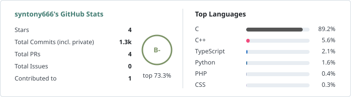

### Hi, I'm Tony

I'm a software engineer working across web applications and backend services. I mainly develop in TypeScript and JavaScript, and occasionally write C for embedded hardware. I care about maintainable systems and practical developer tools.

[Blog](https://blog.syntony666.com)

#### Featured Projects

- **[discord-bot](https://github.com/syntony666/discord-bot)**. A monorepo for a modular Discord bot featuring auto-replies, reaction roles, member notifications, and stream alerts. Built with TypeScript, RxJS, Hono, Prisma, and PostgreSQL.
- **[map-gallery](https://github.com/syntony666/map-gallery)**. An interactive map for organizing photo collections from around Taiwan. Built with React, Vite, Leaflet, Hono, Drizzle, and SQLite.
- **[rlcd-esp32-controller](https://github.com/syntony666/rlcd-esp32-controller)**. ESP32-S3 firmware for controlling a 4.2-inch RLCD display. Built with ESP-IDF and C.

<picture>
  <source media="(prefers-color-scheme: dark)" srcset="./stats/stats-dark.svg">
  
</picture>
